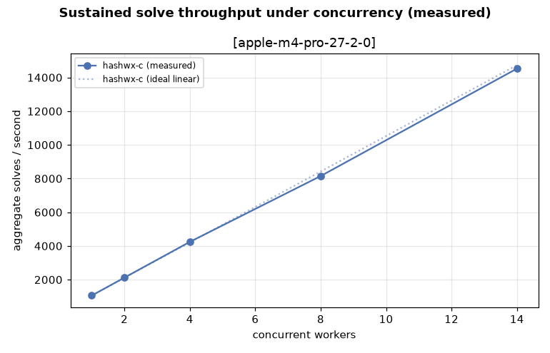
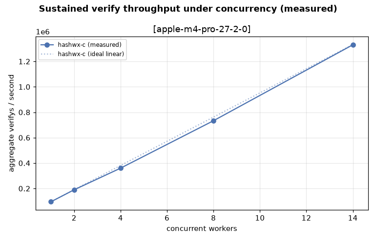
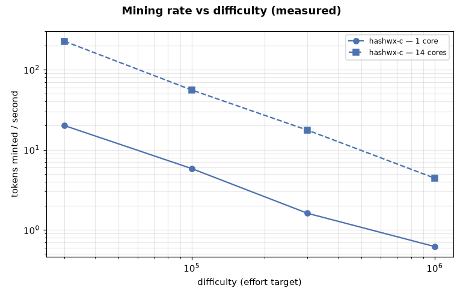

# Equi-X Benchmark Report

- Generated: 2026-11-06T22:13:19+00:00
- Config: `configs/hashwx.toml`
- Devices (CPUs): apple-m4-pro-27-2-0
    - `apple-m4-pro-27-2-0`: Apple M4 Pro (aarch64, cpu)
- `hashwx-c`: version 1.0.0, commit 74b567a31276a4c5d7cb232a5b7639467f49f961, built with clang-21.0.0 (clang-2100.4.1.1)

## Correctness cross-check (interop gate)

_No cross-checks run (e.g. combined report)._

## DoS-protection effectiveness (this system)

Equi-X defends by making requesters *solve* (expensive) while the service only *verifies* (cheap). Protection factor = measured attacker time to craft one accepted token at a given effort ÷ measured verify time. Judged **effective** when ≥ 10000× on every measured point.

**Verdict: EFFECTIVE ✅** (effective from — `apple-m4-pro-27-2-0`: effort ≥ 100000).

At effort 1000000, an attacker needs ~3.81s (impl `hashwx-c`) to craft one accepted request, while the defender verifies in ~10.75µs (**354,498×** asymmetry; one core screens ~93,023 requests/s vs the attacker's ~0.26 tokens/s).

| device | effort | attacker time/token | attacker impl | verify time | protection factor | verify/s | attacker tokens/s |
|---|---|---|---|---|---|---|---|
| apple-m4-pro-27-2-0 | 100000 | 215.852 ms | hashwx-c | 10.750 µs | 20,079× | 93,023 | 4.633 |
| apple-m4-pro-27-2-0 | 1000000 | 3.811 s | hashwx-c | 10.750 µs | 354,498× | 93,023 | 0.262 |

## Sustained throughput under concurrency (measured)

The DoS section above reports **per-core** capacity as 1/latency from a single serial op. This section instead **measures** aggregate throughput with *N* worker processes running at once (N stepping up to the core count), so it captures real memory-bandwidth contention. It is additive — the per-core figures above are unchanged.

Measured on up to **14** concurrent workers. *Peak* is the best aggregate ops/s observed; *knee* is the worker count where it peaks (adding workers past it stops helping). *Naïve N×* is the per-core figure multiplied by the core count — what a linear extrapolation would (over)predict; the *efficiency* column is measured peak ÷ naïve N×.

| impl | operation | 1 worker (per-core) | knee | measured peak | naïve N× | scaling efficiency |
|---|---|---|---|---|---|---|
| hashwx-c | solve | 1,052 ops/s | 14 workers | **14,526 ops/s** | 14,734 ops/s | 99% |
| hashwx-c | verify | 95,238 ops/s | 14 workers | **1,330,713 ops/s** | 1,333,333 ops/s | 100% |

### solve: throughput vs. concurrency

| impl | workers | ok | aggregate ops/s | per-worker ops/s | scaling eff. | peak RSS |
|---|---|---|---|---|---|---|
| hashwx-c | 1 | 1 | 1,052 | 1,052 | 100% | 2 MB |
| hashwx-c | 2 | 2 | 2,118 | 1,059 | 101% | 4 MB |
| hashwx-c | 4 | 4 | 4,241 | 1,060 | 101% | 7 MB |
| hashwx-c | 8 | 8 | 8,150 | 1,019 | 97% | 15 MB |
| hashwx-c | 14 | 14 | 14,526 | 1,038 | 99% | 26 MB |

### verify: throughput vs. concurrency

| impl | workers | ok | aggregate ops/s | per-worker ops/s | scaling eff. | peak RSS |
|---|---|---|---|---|---|---|
| hashwx-c | 1 | 1 | 95,238 | 95,238 | 100% | 4 MB |
| hashwx-c | 2 | 2 | 189,735 | 94,868 | 100% | 8 MB |
| hashwx-c | 4 | 4 | 360,027 | 90,007 | 95% | 16 MB |
| hashwx-c | 8 | 8 | 733,234 | 91,654 | 96% | 32 MB |
| hashwx-c | 14 | 14 | 1,330,713 | 95,051 | 100% | 56 MB |

## Mining rate vs difficulty (measured)

How many effort-qualified tokens can be minted per second at a given difficulty. The **whole-machine** rate is the reliable figure: it averages one streaming search per core over independent nonce ranges. Per-core is that rate divided by the core count (token-find time is heavy-tailed, so the separately-sampled single-core mean is noisier and can even exceed the machine rate ÷ cores at low sample counts — prefer the derived per-core). Mint rate falls ~1/effort, so difficulty sets the rate directly.

**`hashwx-c`** on `apple-m4-pro-27-2-0` (base `abcd`), whole-machine = 14 cores:

| difficulty (effort) | mean attempts/token | tokens/s [14 cores] | tokens/s [1 core, ÷14] |
|---|---|---|---|
| 30000 | 26,790 | **225.50** | 16.107 |
| 100000 | 102,281 | **55.74** | 3.981 |
| 300000 | 339,506 | **17.55** | 1.253 |
| 1000000 | 1,205,758 | **4.43** | 0.316 |

> Over a 33× rise in difficulty (30000→1000000), the machine mint rate fell 51× — ~1/effort, so halving the target roughly doubles the mint rate.

## Comparison plots (every plot compares C vs Rust; with multiple CPUs each plot is faceted per CPU and `xdev_*` charts compare CPUs directly)

> ⚠️ plot 'solve_time_by_runtime.png' requires >=2 implementations to compare, but only found: ['hashwx-c']. Build/enable both C and Rust runners.

> ⚠️ plot 'throughput.png' requires >=2 implementations to compare, but only found: ['hashwx-c']. Build/enable both C and Rust runners.

> ⚠️ plot 'jit_speedup.png' requires >=2 implementations to compare, but only found: ['hashwx-c']. Build/enable both C and Rust runners.

> ⚠️ plot 'peak_rss.png' requires >=2 implementations to compare, but only found: ['hashwx-c']. Build/enable both C and Rust runners.

> ⚠️ plot 'solve_distribution.png' requires >=2 implementations to compare, but only found: ['hashwx-c']. Build/enable both C and Rust runners.

> ⚠️ plot 'verify_time.png' requires >=2 implementations to compare, but only found: ['hashwx-c']. Build/enable both C and Rust runners.

> ⚠️ plot 'compile_overhead.png' requires >=2 implementations to compare, but only found: ['hashwx-c']. Build/enable both C and Rust runners.

> ⚠️ plot 'effort_attempts.png' requires >=2 implementations to compare, but only found: ['hashwx-c']. Build/enable both C and Rust runners.

> ⚠️ plot 'effort_time.png' requires >=2 implementations to compare, but only found: ['hashwx-c']. Build/enable both C and Rust runners.

> ⚠️ plot 'dos_protection.png' requires >=2 implementations to compare, but only found: ['hashwx-c']. Build/enable both C and Rust runners.

### Concurrency Solve

### Concurrency Verify

### Mining Rate

## solve results

| device | challenge | impl | runtime | median | p95 | solves/s | hashes/s | sols/solve | RSS(KB) |
|---|---|---|---|---|---|---|---|---|---|
| apple-m4-pro-27-2-0 | 0000000000000002 | hashwx-c | interpreted | 3.631 ms | 3.865 ms | 275.4 | 18,047,054 | 1.00 | 1824 |
| apple-m4-pro-27-2-0 | 0000000000000002 | hashwx-c | compiled | 1.025 ms | 1.147 ms | 975.6 | 63,933,663 | 1.00 | 1856 |
| apple-m4-pro-27-2-0 | 0000000000000002 | hashwx-c | compiled | 1.017 ms | 1.097 ms | 983.4 | 64,449,764 | 1.00 | 1856 |
| apple-m4-pro-27-2-0 | cafe | hashwx-c | interpreted | 3.558 ms | 3.912 ms | 281.0 | 18,417,828 | 1.00 | 1824 |
| apple-m4-pro-27-2-0 | cafe | hashwx-c | compiled | 1.011 ms | 1.071 ms | 989.1 | 64,824,294 | 1.00 | 1856 |
| apple-m4-pro-27-2-0 | cafe | hashwx-c | compiled | 992.562 µs | 1.054 ms | 1007.5 | 66,027,076 | 1.00 | 1856 |
| apple-m4-pro-27-2-0 | deadbeef | hashwx-c | interpreted | 3.538 ms | 3.805 ms | 282.6 | 18,522,478 | 1.00 | 1840 |
| apple-m4-pro-27-2-0 | deadbeef | hashwx-c | compiled | 1.028 ms | 1.075 ms | 972.9 | 63,757,423 | 1.00 | 1856 |
| apple-m4-pro-27-2-0 | deadbeef | hashwx-c | compiled | 1.039 ms | 1.109 ms | 962.1 | 63,054,551 | 1.00 | 1840 |

## verify results

| device | challenge | impl | runtime | median | p95 | result | RSS(KB) |
|---|---|---|---|---|---|---|---|
| apple-m4-pro-27-2-0 | 0000000000000002 | hashwx-c | interpreted | 17.417 µs | 18.625 µs | OK | 2064 |
| apple-m4-pro-27-2-0 | 0000000000000002 | hashwx-c | compiled | 11.041 µs | 13.625 µs | OK | 2080 |
| apple-m4-pro-27-2-0 | 0000000000000002 | hashwx-c | compiled | 11.125 µs | 13.750 µs | OK | 2080 |
| apple-m4-pro-27-2-0 | cafe | hashwx-c | interpreted | 17.459 µs | 18.750 µs | OK | 2064 |
| apple-m4-pro-27-2-0 | cafe | hashwx-c | compiled | 11.000 µs | 13.333 µs | OK | 2080 |
| apple-m4-pro-27-2-0 | cafe | hashwx-c | compiled | 10.750 µs | 13.375 µs | OK | 2080 |
| apple-m4-pro-27-2-0 | deadbeef | hashwx-c | interpreted | 17.542 µs | 18.958 µs | OK | 2064 |
| apple-m4-pro-27-2-0 | deadbeef | hashwx-c | compiled | 11.084 µs | 13.417 µs | OK | 2080 |
| apple-m4-pro-27-2-0 | deadbeef | hashwx-c | compiled | 11.084 µs | 13.708 µs | OK | 2080 |

## hashx_compile results

| device | challenge | impl | runtime | median compile | median exec | RSS(KB) |
|---|---|---|---|---|---|---|
| apple-m4-pro-27-2-0 | 0102030405060708 | hashwx-c | interpreted | 1.750 µs | 14.375 µs | 1920 |
| apple-m4-pro-27-2-0 | 0102030405060708 | hashwx-c | compiled | 7.875 µs | 3.125 µs | 1936 |
| apple-m4-pro-27-2-0 | deadbeef | hashwx-c | interpreted | 1.916 µs | 15.791 µs | 1920 |
| apple-m4-pro-27-2-0 | deadbeef | hashwx-c | compiled | 7.750 µs | 3.083 µs | 1936 |

## effort results

| device | base | target | impl | runtime | mean attempts | median time | mean achieved |
|---|---|---|---|---|---|---|---|
| apple-m4-pro-27-2-0 | abcd | 1000000 | hashwx-c | compiled | 1859080.0 | 3.811 s | 11328580 |
| apple-m4-pro-27-2-0 | abcd | 100000 | hashwx-c | compiled | 98549.0 | 215.852 ms | 199929 |

---
_See `results.csv` for the full flat dataset and `raw/results.json` for per-rep data._